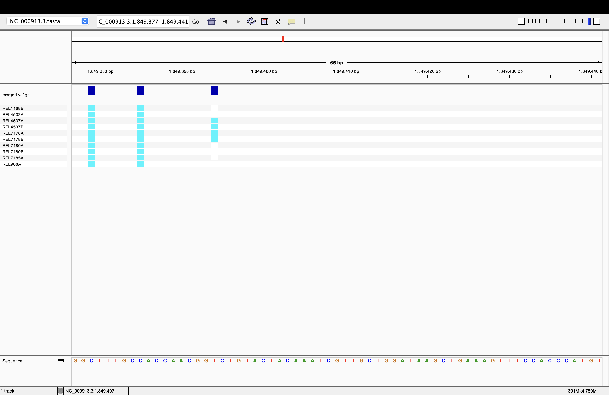
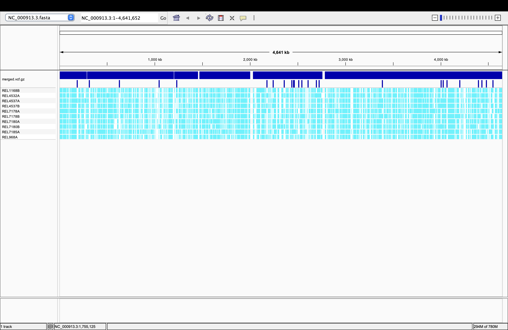

# Week 09: Automated multi-sample variant calling with a design file

This workflow automates the single-sample variant-calling Makefile from previous weeks so it can run across many samples from one BioProject, using a `design.csv` file and GNU `parallel` to launch one job per sample, then merges the per-sample VCFs into a single multi-sample VCF.

## BioProject summary

**BioProject [PRJNA295606](https://www.ncbi.nlm.nih.gov/bioproject/PRJNA295606)** — *Escherichia coli* B str. REL606, "E. coli genome evolution over 50,000 generations." 

- **Samples in the BioProject:** 224 SRA experiments / 224 BioSamples,
  ~177 Gbases total.
- **What the project studies:** how asexual *E. coli* populations accumulate
  mutations and adapt over tens of thousands of generations under constant
  lab conditions.
- **Samples used here:** 10 paired-end runs selected from this BioProject.

  | run_accession | sample_alias |
  | --- | --- |
  | SRR2584783 | REL4537B |
  | SRR2584880 | REL7180A |
  | SRR2584679 | REL4532A |
  | SRR2584715 | REL4537A |
  | SRR2584897 | REL1168B |
  | SRR2584830 | REL7178B |
  | SRR2584881 | REL7180B |
  | SRR2584681 | REL7185A |
  | SRR2584819 | REL7178A |
  | SRR2584892 | REL968A |

  Note: `PRJNA295606` contains a mix of paired-end and single-end runs; the
  Makefile's `bwa mem` alignment step requires paired-end reads, so
  candidates were filtered to `library_layout == PAIRED` before selecting
  the 10 smallest runs.
- **Reference genome:** `NC_000913.3` (*E. coli* K-12 MG1655), reused from
  Week 05. 
  
## The design file
`design.csv` was generated directly from the BioProject's SRA metadata.

Each row is a unique run; `run_accession` maps to `SRR` and `sample_alias`
maps to `SAMPLE` in the Makefile, matching the `{run_accession}` /
`{sample_alias}` placeholders used by `parallel --header :`.

## How to run

**1. Single-sample test** 

```sh
make all SRR=SRR2584783 SAMPLE=REL4537B
```

This produces `vcf/REL4537B.vcf.gz`

**2. Batch run**

```sh
make batch
```

```sh
cat design.csv | parallel --colsep , --header : --eta --lb -j 3 \
    make SRR={run_accession} SAMPLE={sample_alias} N=155000 THREADS=2 all
```
**3. Merge into one multi-sample VCF:**

```sh
make merge
```

This runs `bcftools merge` across every `vcf/*.vcf.gz` file and writes:

- `results/merged.vcf.gz` (+ `.csi` index)
- `results/merged.stats.txt`

### Verified output

```sh
$ bcftools query -l results/merged.vcf.gz
REL1168B
REL4532A
REL4537A
REL4537B
REL7178A
REL7178B
REL7180A
REL7180B
REL7185A
REL968A

$ grep "number of samples" results/merged.stats.txt
SN  0  number of samples:  10

$ grep "number of records" results/merged.stats.txt
SN  0  number of records:  37123
```

All 10 samples are present in the merged VCF

```sh
$ bcftools query -f '%CHROM\t%POS[\t%GT]\n' results/merged.vcf.gz | head
NC_000913.3  301  1 1 1 1 1 1 1 1 1 1
NC_000913.3  323  . . . . . . . . 1 .
NC_000913.3  393  1 1 1 1 1 1 1 1 1 1
NC_000913.3  529  . . . . . . 1 . . .
NC_000913.3  588  1 1 1 1 1 1 1 1 1 1
```

Positions 301/393/588 are called `1` (alt) in all 10 samples, which is  consistent with fixed REL606-vs-K12 strain differences. Positions 323 and 529 are called in only
one sample each, with `.` (missing genotype) in the other nine which is the expected "hole" behavior of the per-sample-call-then-merge approach

**To reproduce from scratch:**

```sh
make clean
make batch
make merge
```

## IGV visualization and findings




The merged VCF (results/merged.vcf.gz) was loaded alongside the reference NC_000913.3.fasta in IGV.

As we can see at the whole-genome view, variants are not spread evenly across the chromosome. Zooming into a representative region (NC_000913.3:1,849,377-1,849,441) shows three adjacent SNPs. The first two are called in all 10 samples. The third SNP, however, is only called in REL4537A and REL7178A.