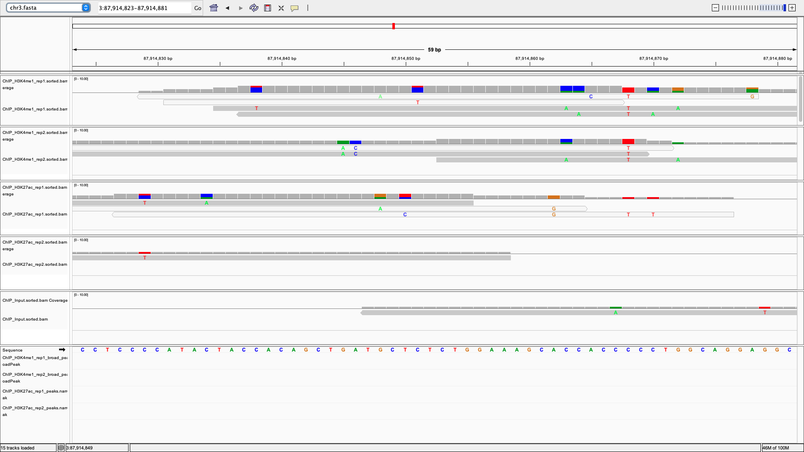
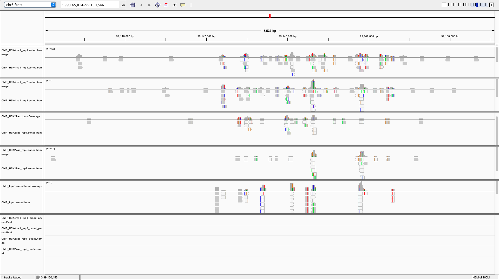
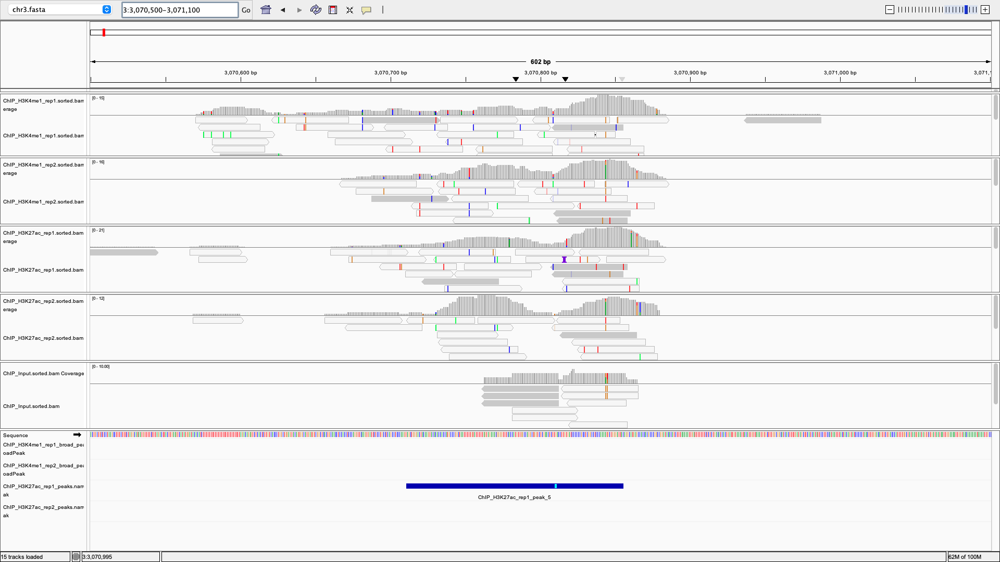
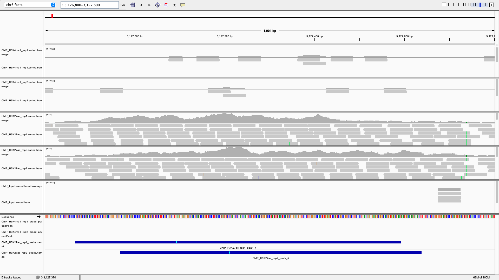

# Week 10: ChIP-seq peak calling

This reuse the week09 `design.csv` + `parallel` automation pattern, replacing variant calling with **MACS3 peak calling** for ChIP-seq histone-mark data.

## Project summary

- **BioProject:** [PRJNA214613](https://www.ncbi.nlm.nih.gov/bioproject/PRJNA214613), the "Nucleosome Positioning" study
- **Assay:** ChIP-seq, single-end
- **Organism:** *Homo sapiens*, restricted to **chromosome 3** 
- **Samples:** 2 histone marks x 2 replicates + 1 shared input control (5 samples total)

| Run | Mark | Replicate | Role |
| --- | --- | --- | --- |
| SRR949136 | H3K4me1 | rep1 | ChIP |
| SRR949137 | H3K4me1 | rep2 | ChIP |
| SRR949140 | H3K27ac | rep1 | ChIP |
| SRR949141 | H3K27ac | rep2 | ChIP |
| SRR949142 | Input | — | Background, shared by all 4 ChIP samples |

H3K4me1 marks poised/active enhancers; H3K27ac marks active enhancers and promoters. Each run was subsampled to the first 10,000,000 reads to keep the pipeline fast.

## How to run

From this directory, with the `bioinfo` conda env active:

```sh
make background      
make batch            
make batch-peaks     
```

### Outputs

- `bam/<sample>.sorted.bam` — aligned, sorted, indexed reads
- `peaks/<sample>_peaks.narrowPeak` — peak intervals and scores
- `peaks/<sample>_summits.bed` — position of maximum enrichment per peak
- `peaks/<sample>_peaks.xls` — readable peak summary

## Peak counts (narrow mode, q < 0.01)

| Sample | Peaks called |
| --- | --- |
| ChIP_H3K4me1_rep1 | 8 |
| ChIP_H3K4me1_rep2 | 13 |
| ChIP_H3K27ac_rep1 | 3,711 |
| ChIP_H3K27ac_rep2 | 3,892 |

**H3K27ac replicates agree closely in magnitude (3,711 vs 3,892). H3K4me1 called far fewer peaks (8 vs 13) under the same narrow-peak settings.**

This gap is expected and not a pipeline failure since  H3K4me1 is a broad-domain mark that spreads signal over wide, low-intensity regions, while H3K27ac produces sharp, strong enrichment that narrow-peak mode is designed to detect. Re-running the H3K4me1 samples with `macs3 callpeak --broad` (same input, same q-value) recovered substantially more regions:

| Sample | Narrow peaks | Broad peaks (`--broad`) |
| --- | --- | --- |
| ChIP_H3K4me1_rep1 | 8 | 135 |
| ChIP_H3K4me1_rep2 | 13 | 322 |

This shows andn confirms the low narrow-peak count for H3K4me1 reflects a mismatch between peak-calling mode and the mark's biology (and lower effective depth from the 10M-read/chr3-only subsampling), not a broken alignment or control comparison. 

## Replicate consistency

- **H3K27ac:** both replicates called thousands of peaks at similar counts (3,711 / 3,892), indicating reasonably consistent enrichment calling between replicates under narrow-peak mode.
- **H3K4me1:** narrow mode calls too few peaks per replicate (8 / 13) to assess overlap meaningfully; broad mode (135 / 322) is the appropriate comparison for this mark, though rep2 still calls ~2.4x more regions than rep1, suggesting rep2 has higher effective sensitivity.

To quantify overlap directly:

```sh
bedtools intersect -u -a peaks/ChIP_H3K27ac_rep1_peaks.narrowPeak -b peaks/ChIP_H3K27ac_rep2_peaks.narrowPeak | wc -l
bedtools intersect -u -a peaks/ChIP_H3K4me1_rep1_broad_peaks.broadPeak -b peaks/ChIP_H3K4me1_rep2_broad_peaks.broadPeak | wc -l
```

### Region of agreement
Here is the IGV for the region of agreement found from running the script above



### Region of disagreement

Here is the IGV for the region of disagreement found from running the script above



### General IGV screenshots




