# Week 11: Evaluate Gene Expression Coverages

## Look at a wide region (millions of bases wide). How are the two sample types different?

HBR shows broad, low-level transcription across many genes which is consistent with a complex tissue expressing a large, diverse gene set modestly. UHR shows a narrower set of genes but at much higher levels which is againb consistent with actively dividing cancer cells strongly overexpressing a smaller proliferation-related gene set. 

## Navigate across the genome. How consistent are the replicates?
There are regions with clearly consistent replicates, however there are also some regions where the replicates aren't as consistent. For example, for the position chr22:40,092,821–40,100,486 there is dense, similarly-distributed peaks across all 6 samples, both groups, but for chr22:15,531,624–15,546,954, there aren't. 

## Find a gene that is not expressed in any of the samples.
ENSG00000277248.1 (chr22:10,736,171–10,736,283) is a gene which shows 0 reads in featureCounts output, confirmed from the count table along with visual inspection.

## Find a gene that is very strongly expressed in all samples. What is its coverage?
HAVANA and MICAL3 are both dense and have consistent coverage across all 6 samples.

## Can you identify the transcripts that are expressed? Sometimes you can only exclude some candidates.
At chr22:50,139,015–50,146,680, I can see that the GTF track shows several annotated exon blocks, but coverage only appears over a subset of them, and which subset differs between samples. Some isoforms can be excluded since their unique exons have no coverage, but the exact expressed isoform can't be descovered from coverage alone.

## Can you find a gene/transcript where the expression is clearly different between the two sample types? What is the fold change?
LINC01399 (chr22:35,187,223–35,194,888) is a good example of a gene where experession is clearly different between the two sample types. Here is why:

For HBR_1, HBR_2, HBR_3: completely flat, zero coverage
and for, UHR_1, UHR_2, UHR_3: all three show a consistent peak shape and height in the same location

## Is the transcript upregulated or downregulated?

This transcript is upregulated. 

## How certain are you that it is not a random fluctuation? Why?
I am fairly certain that this is not a random fluctutaiton since all 3 UHR replicates independently show the same peak shape/location, and all 3 HBR replicates independently show zero, This agreement provides a high condifence that this is not due to random fluctuation. 

## Images

Images showing the work are provided below. 
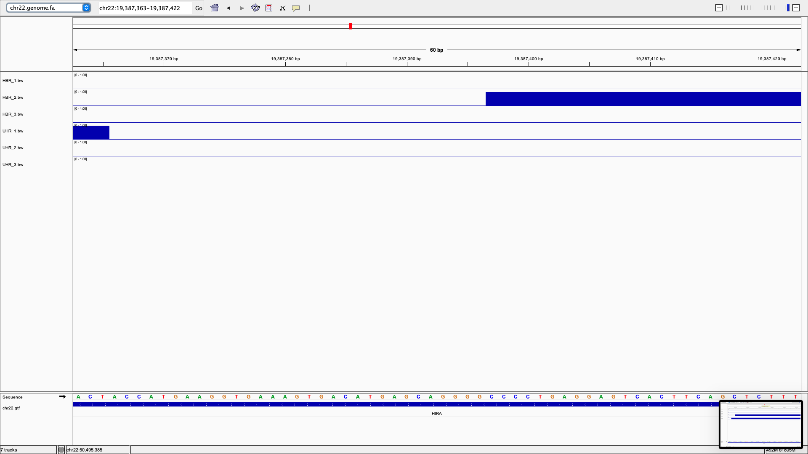
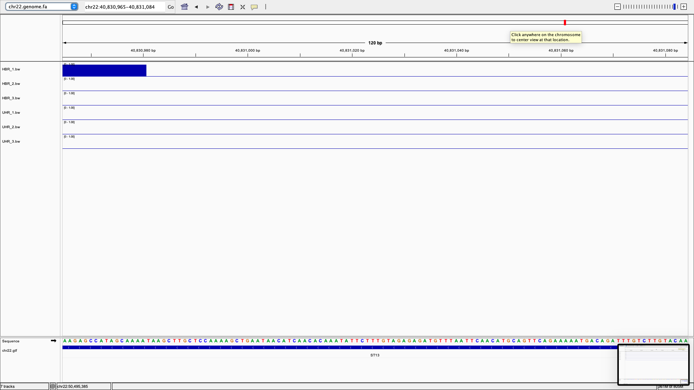
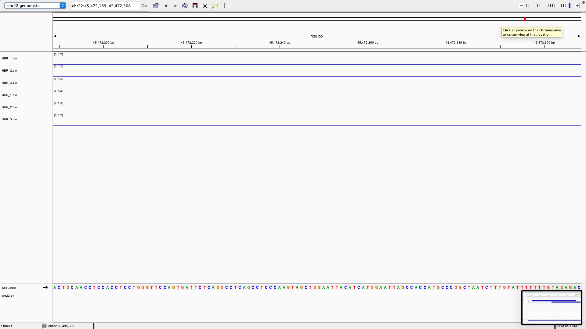
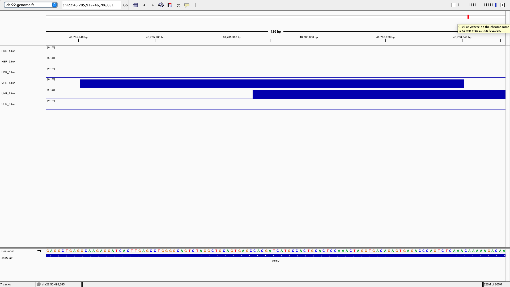
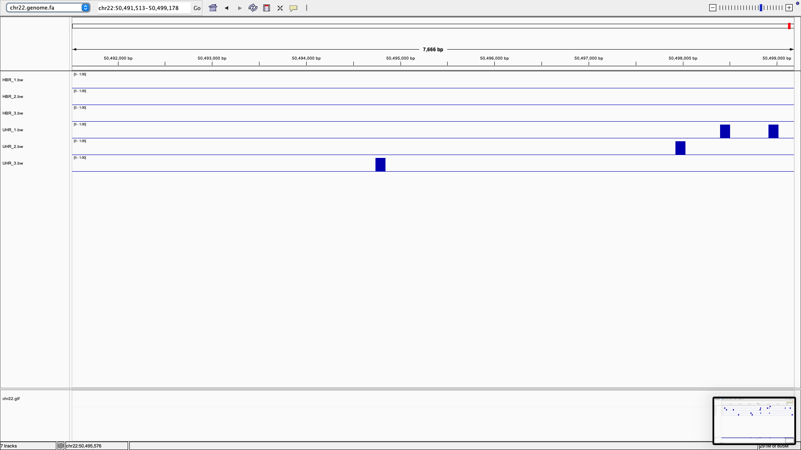
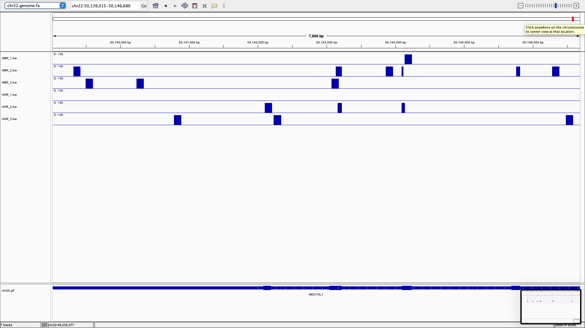
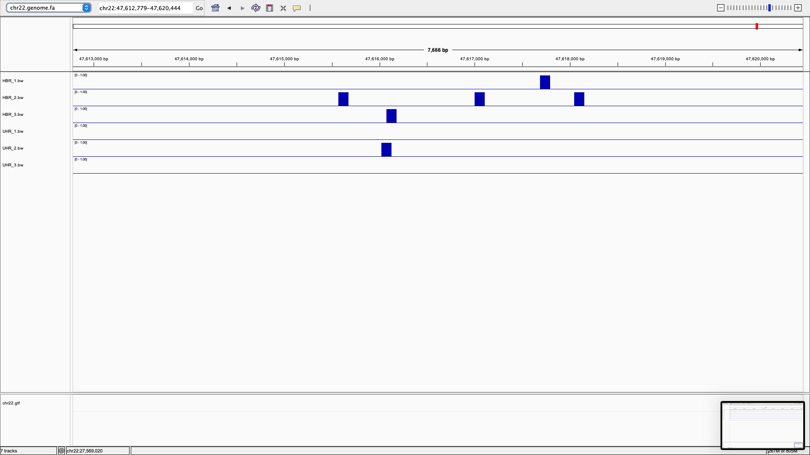
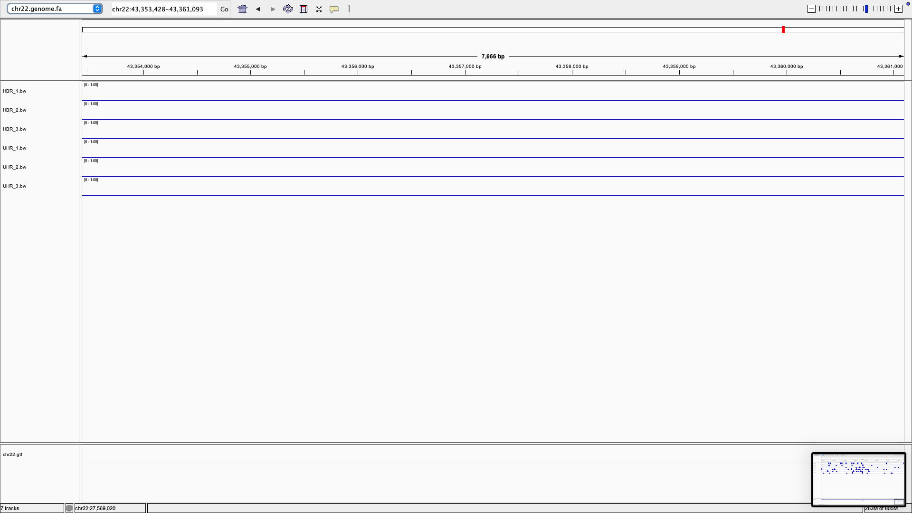
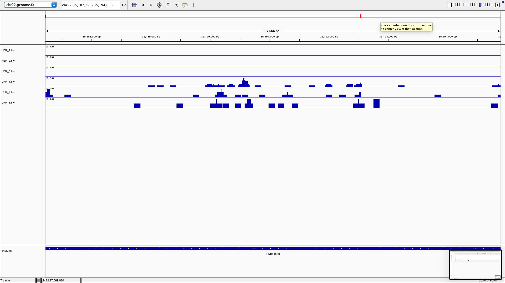
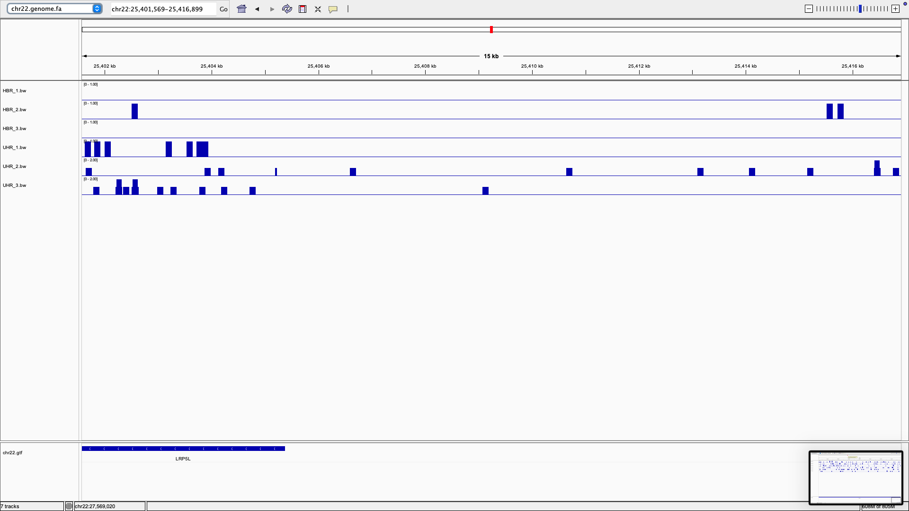
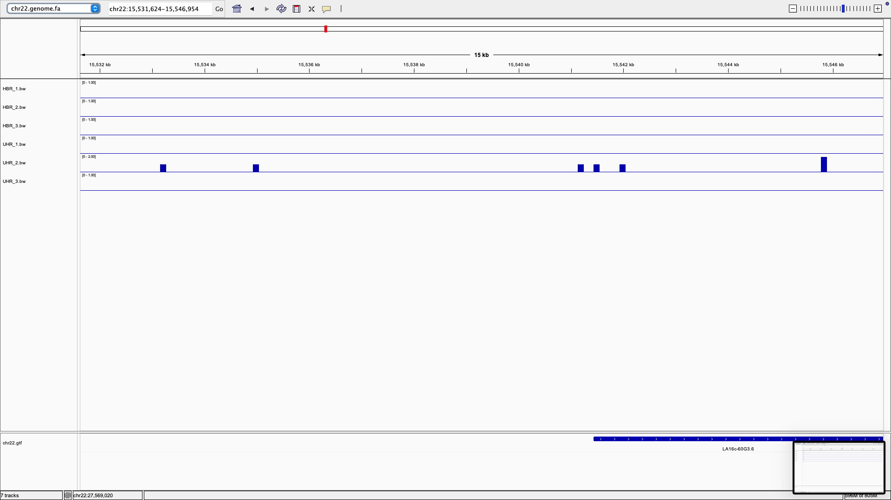
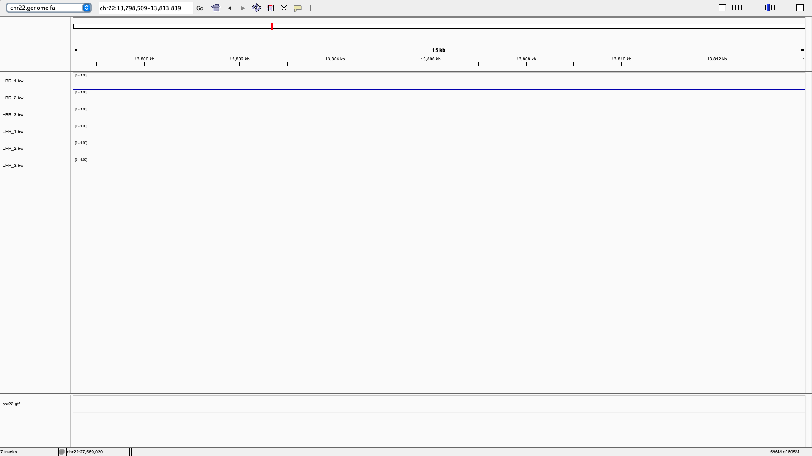
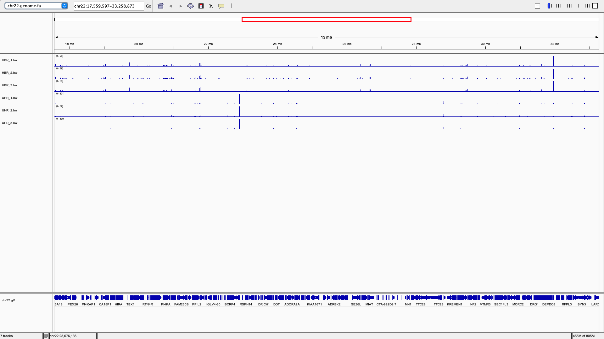
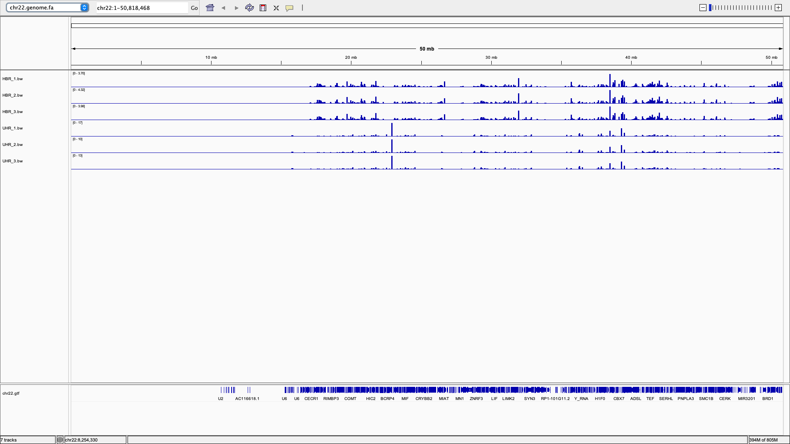
